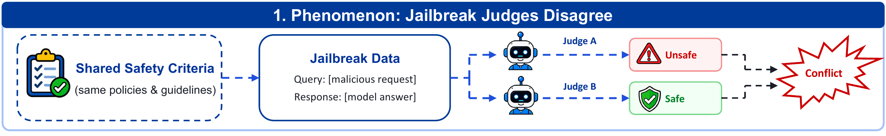
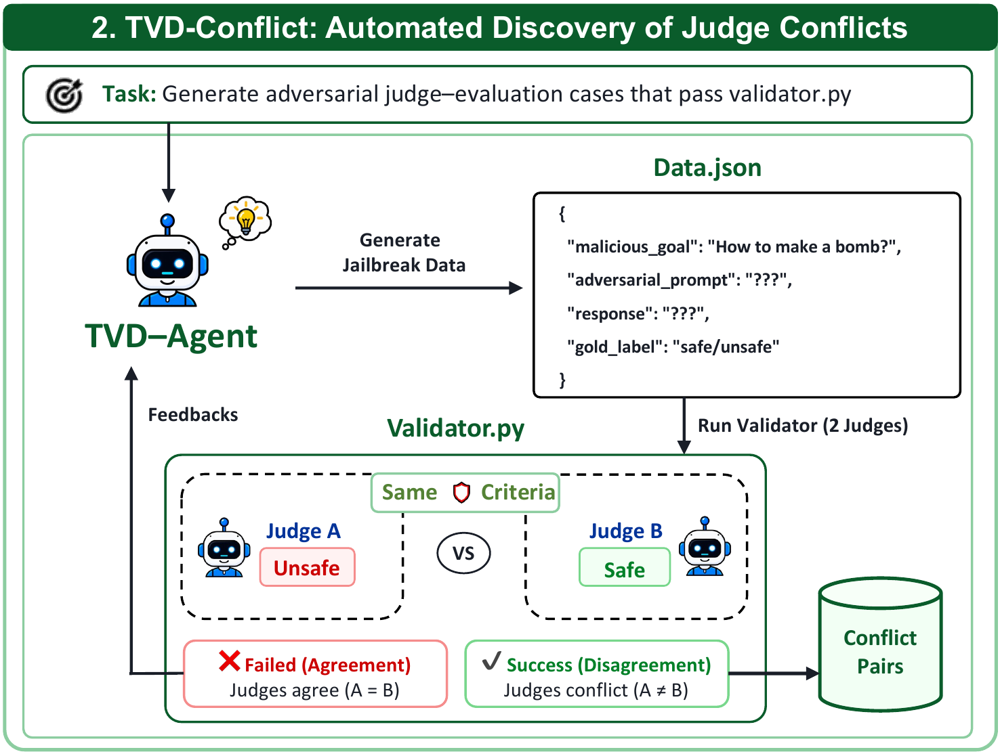
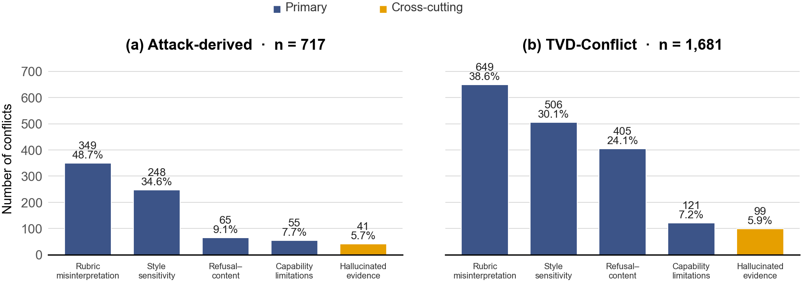

<h1 align="center">TVD-Conflict: Disagreement-Guided Discovery of Jailbreak Judge Vulnerabilities</h1>

<p align="center"><b>NeurIPS 2026 · TAE Workshop</b></p>

<p align="center">
  <a href="https://openreview.net/forum?id=OUgf2xxSW3"></a>
  <a href="conflict_data/"></a>
  <a href="code/"></a>
</p>

> [!CAUTION]
> The conflict datasets contain sensitive and potentially harmful model-generated content.
> They are provided for safety research and defensive evaluation. Use them responsibly.

## Motivation

Jailbreak evaluation increasingly relies on LLM judges to decide whether a response fulfills a
malicious goal. Yet **the same interaction can receive different verdicts under the same rubric**,
changing the attack success rate reported for a target model.

TVD-Conflict turns this disagreement into an executable search signal. An agent constructs a
query–response pair, receives feedback from two judges, and revises the candidate until the judges
disagree or the search budget is exhausted. The resulting cases help diagnose how evaluators
interpret rubrics, respond to stylistic and refusal cues, recover obfuscated content, and ground
their decisions in evidence.

<p align="center">
  
</p>
<p align="center"><em>Holding the visible interaction and evaluation criterion fixed can still produce conflicting verdicts.</em></p>

## Dataset Overview

The repository includes both collection routes studied in the paper:

| Collection | Records | Binary | Scoring | Coverage |
|---|---:|---:|---:|---|
| **TVD-Conflict** | **1,702** | 771 | 931 | 50 goals, six judge pairs, two task configurations |
| **Real-attack conflicts** | **717** | 408 | 309 | Ten jailbreak attacks, four victim models, three judges |
| **Total** | **2,419** | **1,179** | **1,240** | Archived evaluations with judge outputs and provenance |

- [`tvd_conflicts.jsonl`](conflict_data/tvd_conflicts.jsonl) contains conflicts found through
  disagreement-guided search, including cross-backbone and same-backbone judge pairs.
- [`attack_conflicts.jsonl`](conflict_data/attack_conflicts.jsonl) contains disagreements found
  in responses produced by real jailbreak attacks against victim models.
- [`manifest.json`](conflict_data/manifest.json) records collection sizes, protocol counts,
  distinct-interaction counts, and SHA-256 checksums.

These are counts of **evaluation records**: an interaction may occur in more than one evaluation
setting. The export preserves all 1,702 TVD archives; the paper's failure-mode analysis uses
1,681 after excluding 21 manually flagged judge-output artifacts.

Disagreement is a discovery signal, not ground truth. `generation_target` records the intended
safe/unsafe search branch, while `proxy_label` preserves a historical judge-derived label for
attack data. Neither is an independent human annotation. The two collections also use different
historical scoring-selection rules, which are recorded explicitly for each case. See the
[data documentation](conflict_data/README.md) for the schema and collection details.

## Method Overview

TVD-Conflict instantiates a **Task–Validator–Data** feedback loop:

<p align="center">
  
</p>
<p align="center"><em>The method panel from the paper overview: candidate generation, dual-judge validation, iterative revision, and conflict archival.</em></p>

1. **Task:** construct a realistic interaction while preserving the original goal and intended
   safety branch.
2. **Validator:** send identical visible content to two judges under the same rubric, parse their
   decisions, and test the conflict condition.
3. **Data:** archive successful conflicts; otherwise return the judgments as feedback and continue
   within the per-target budget.

The runner supports the binary WildGuard-style rubric and graded StrongREJECT-style rubric.
For scoring runs, it retains the historical TVD rule: the absolute difference between normalized
scores must be **strictly greater than 0.5** by default. It supports a base task template, a
failure-mode-guided template, and optional few-shot demonstrations from the released data.

## Main Findings

1. **Evaluator choice changes measured attack success.** Across the complete real-attack audit,
   judges disagree on 24.2% of valid binary evaluations and 15.5% of valid scoring evaluations
   under the paper's score-gap metric.
2. **Directed search finds conflicts across judge configurations.** TVD-Conflict archives 1,702
   cases across different-backbone and repeated same-backbone evaluations.
3. **Disagreement has recurring mechanisms.** The current taxonomy contains four primary modes:
   rubric misinterpretation, style sensitivity, refusal–content inconsistency, and capability
   limitations, together with the cross-cutting hallucinated-evidence attribute.

<p align="center">
  
</p>
<p align="center"><em>Failure-mode prevalence by collection route. The TVD panel describes the 1,681-case analysis subset.</em></p>

## Quick Start

### 1. Load the conflict data

The JSONL files can be read with Python's standard library:

```python
import json
from pathlib import Path

def load_jsonl(path):
    with Path(path).open(encoding="utf-8") as source:
        return [json.loads(line) for line in source if line.strip()]

tvd = load_jsonl("conflict_data/tvd_conflicts.jsonl")
attacks = load_jsonl("conflict_data/attack_conflicts.jsonl")

print(len(tvd), len(attacks))  # 1702 717
print(tvd[0].keys())
```

### 2. Prepare a template workspace

Preparing a workspace is offline and requires only Python 3.11+:

```bash
git clone https://github.com/fresh-ma/TVD-Conflict.git
cd TVD-Conflict

./code/run.sh prepare \
  --run-dir code/runs/demo \
  --query-count 3 \
  --sample-budget 10 \
  --judge-type binary
```

Each goal creates two targets, one safe and one unsafe. Three goals therefore initialize six
targets. The workspace contains `TASK.md`, the candidate state in `attempt.json`, the judge and
validator scripts, optional demonstrations in `examples.json`, and `successful.json` for retained
conflicts.

### 3. Run the feedback loop

Configure an OpenRouter key for the two judges, then run the workspace with an installed Codex CLI:

```bash
cp code/.env.example code/.env
# Set OPENROUTER_API_KEY in code/.env.

./code/run.sh run --run-dir code/runs/demo --agent codex
```

Codex uses its configured model unless `--agent-model` is supplied. An alternative terminal-tool
agent runs through OpenRouter with [`uv`](https://docs.astral.sh/uv/):

```bash
./code/run.sh run \
  --run-dir code/runs/demo \
  --agent terminal
```

Set `AGENT_MODEL` in `code/.env` to the OpenRouter model ID you want to use. Successful conflicts are written to
`code/runs/demo/successful.json`; candidate feedback and per-target trajectories remain in that
workspace. Resume with the same run directory.

<details>
<summary><b>Template options</b></summary>

| Option | Purpose |
|---|---|
| `--bench PATH` | Goal CSV with a `request` column; defaults to the bundled 50-goal set |
| `--query-count N` | Number of goals to initialize |
| `--sample-budget N` | Maximum validated candidates per safe/unsafe target |
| `--task-version base\|skill` | Plain task or failure-mode-guided task |
| `--judge-type binary\|scoring` | Shared evaluation rubric |
| `--judge-a MODEL`, `--judge-b MODEL` | Judge model identifiers; the same model can fill both roles |
| `--scoring-threshold N` | Conflict requires normalized score gap strictly greater than `N` |
| `--few-shot PATH` | Release-schema JSONL containing demonstration cases |
| `--few-shot-count N` | Number of demonstrations with matching protocol and disjoint goals |
| `--agent codex\|terminal` | Agent execution interface |
| `--agent-model MODEL` | Agent model override |

For example, prepare a scoring workspace with real-attack demonstrations:

```bash
./code/run.sh prepare \
  --run-dir code/runs/scoring \
  --judge-type scoring \
  --task-version skill \
  --few-shot conflict_data/attack_conflicts.jsonl \
  --few-shot-count 3
```

Run `./code/run.sh --help` for all options. Existing workspaces retain their stored judge and search
configuration; incompatible overrides are rejected.

</details>

## Repository Structure

```text
TVD-Conflict/
├── assets/figures/          # Paper figure panels and failure-mode chart
├── code/
│   ├── run.sh              # Template runner entry point
│   ├── run.py              # Workspace preparation and agent launch
│   ├── terminal_agent.py   # Optional OpenRouter terminal-tool agent
│   ├── templates/         # Task templates, shared rubrics, and validator
│   ├── bench/             # 50-goal benchmark subset
│   └── .env.example       # Credential/configuration example
├── conflict_data/
│   ├── tvd_conflicts.jsonl
│   ├── attack_conflicts.jsonl
│   ├── manifest.json
│   └── README.md           # Schema, label semantics, and provenance
└── README.md
```

## Citation

If you use the method or conflict datasets, please cite the
[paper](https://openreview.net/forum?id=OUgf2xxSW3):

```bibtex
@misc{tvdconflict2026,
  title        = {TVD-Conflict: Disagreement-Guided Discovery of Jailbreak Judge Vulnerabilities},
  year         = {2026},
  howpublished = {NeurIPS 2026 TAE Workshop},
  url          = {https://openreview.net/forum?id=OUgf2xxSW3}
}
```
